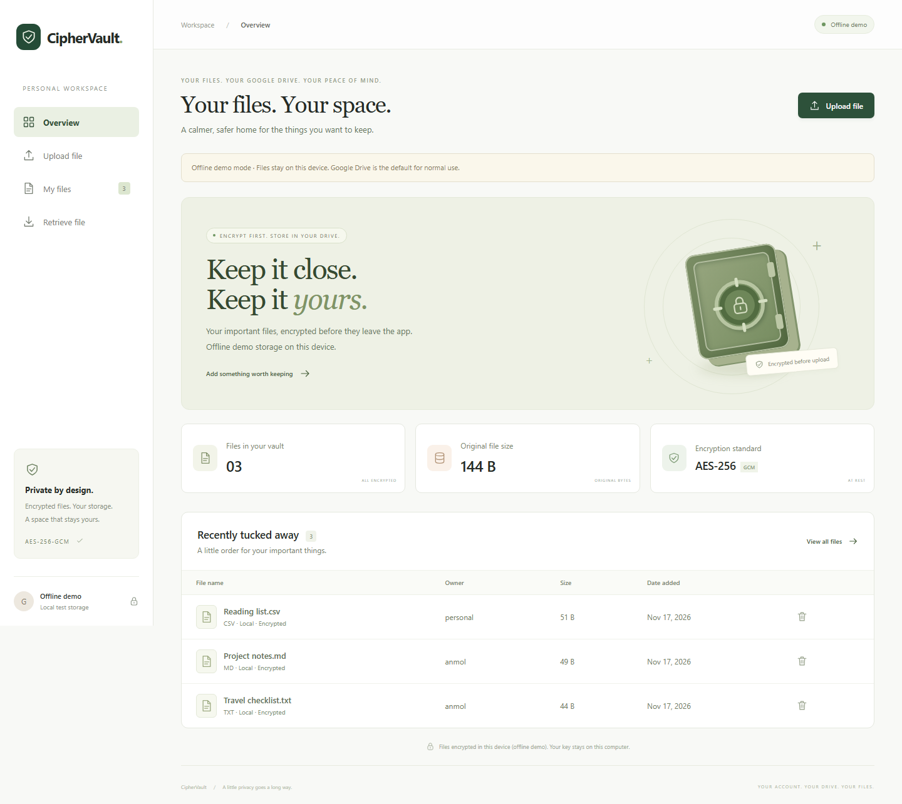
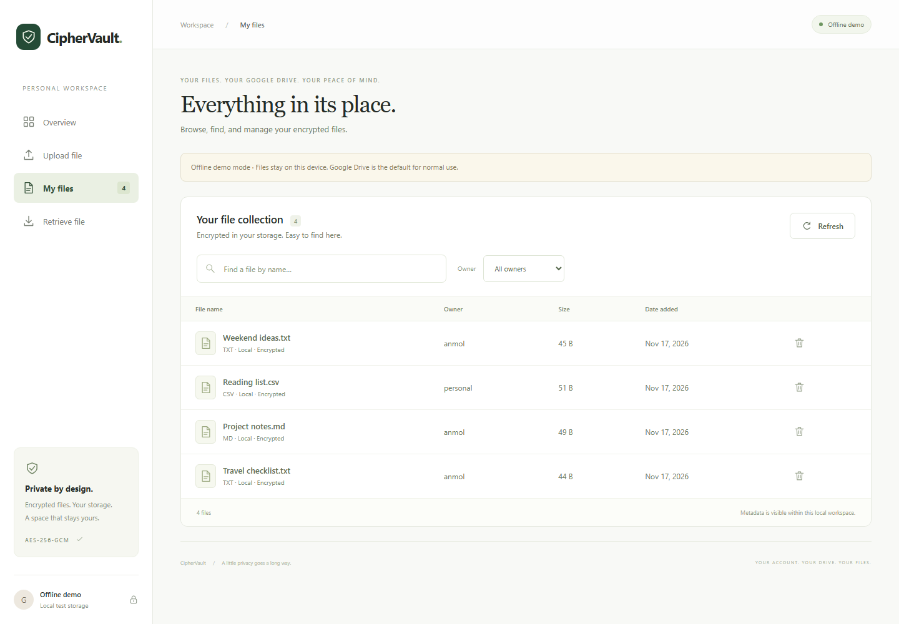
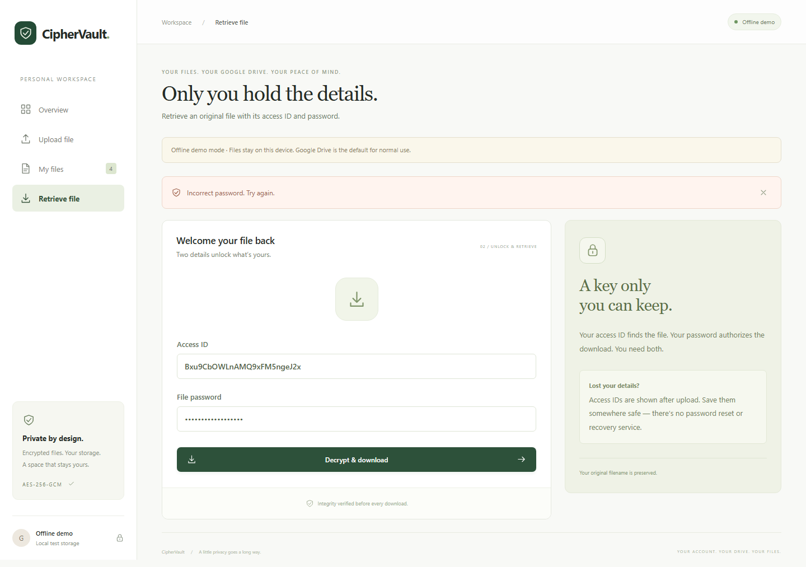
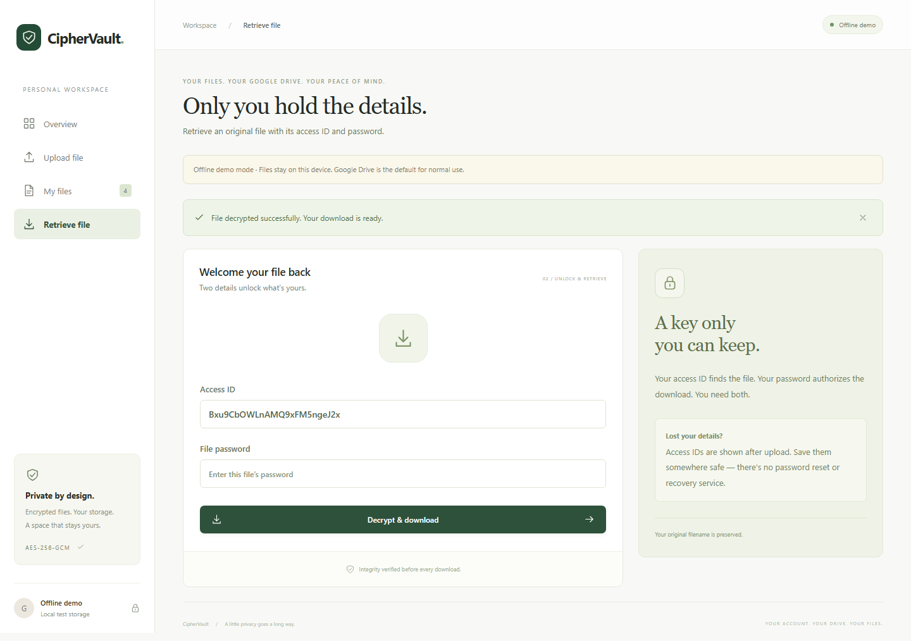
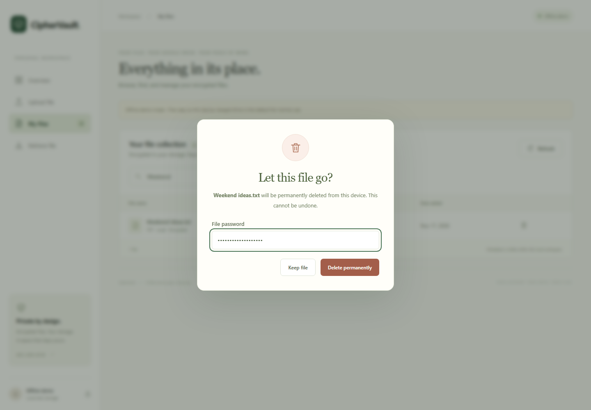
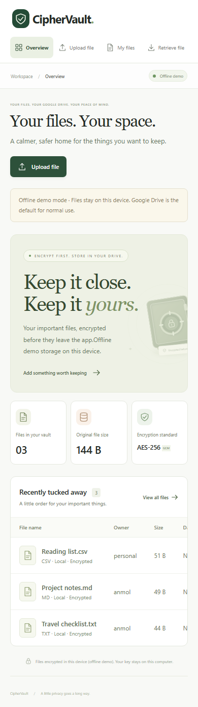
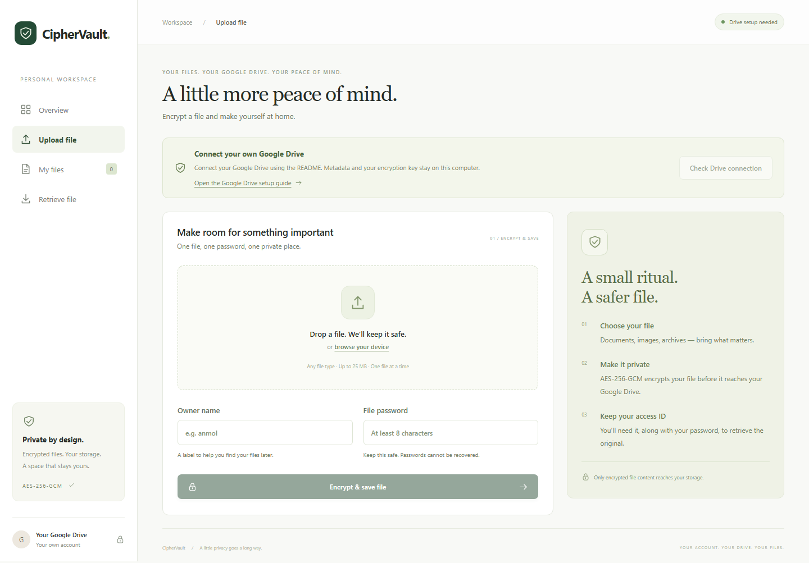
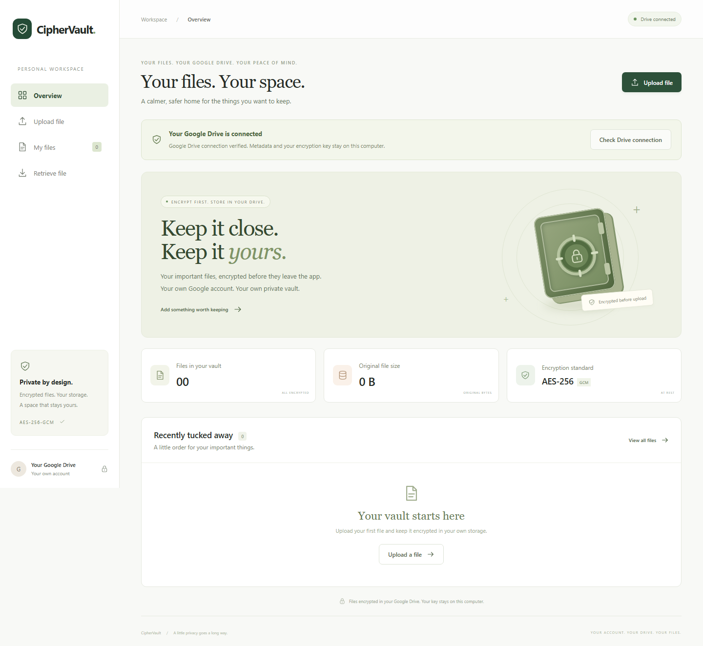

# CipherVault

## Before and after

**Before:** A basic React interface used Google Drive for encrypted files, Supabase for metadata, and Vercel/Render hosting.

**After:** A redesigned, responsive app runs on your computer and **keeps Google Drive storage**, using each person's own Google OAuth credentials. SQLite stores metadata locally, the encryption key persists across restarts, and no hosted frontend, backend, or database is required.

### Keep it close. Keep it yours.

Encrypt files before uploading them to **your own Google Drive**. Browse your collection, retrieve originals with an access ID and password, and confirm deletion with the file password. Built with React, FastAPI, SQLite, Google Drive API, AES-256-GCM, and bcrypt.

**Local app + your Google Drive.** Internet access and your own Google authorization are required for Drive uploads, downloads, and deletion. Vercel, Render, and Supabase are not needed. Google credentials are never bundled with this repository or entered into the frontend.



## Run the app

You need Python **3.11 or newer** recommended for the Google client libraries, Node.js **22.12 or newer**, npm, Git, and a Google account with Drive available. The code also ran in the available Python 3.10.11 test environment, where the Google SDK warns that Python 3.10 is no longer supported for future updates.

### 1. Clone and install

```powershell
git clone https://github.com/Anmol-Kapil/CipherVault.git
cd CipherVault
python -m venv .venv
.\.venv\Scripts\python.exe -m pip install -r requirements.txt
cd frontend
npm ci
cd ..
```

On macOS/Linux, use `.venv/bin/python` instead of `.\.venv\Scripts\python.exe` throughout this guide.

### 2. Connect your own Google Drive

Each person who clones CipherVault sets up **their own OAuth client and Google account**. A plain API key identifies a project but does not authorize access to private Drive files. This project uses the Desktop app OAuth flow from [Google's Python quickstart](https://developers.google.com/workspace/drive/api/quickstart/python).

1. Create or select your project in [Google Cloud Console](https://console.cloud.google.com/), and enable **Google Drive API**.
2. Configure the Google Auth platform branding and audience. For a personal Gmail account, use an **External** audience and add your own Google account as a test user if the app is in testing mode.
3. Create an **OAuth client ID** with application type **Desktop app**. Download its JSON file, rename it **`credentials.json`**, and put it in the repository root. Do not use a service-account JSON or a Web application client.
4. Copy the provided configuration template:

   ```powershell
   Copy-Item .env.example .env
   ```

   On macOS/Linux: `cp .env.example .env`.

5. From the repository root, run:

   ```powershell
   .\.venv\Scripts\python.exe -m backend.drive_auth
   ```

6. Your browser opens Google's authorization flow. Sign in to **your own account**, review the requested access, and authorize it yourself. The command saves `token.json` locally for later requests. Never upload this file or your credentials to GitHub.
7. Verify the authorization:

   ```powershell
   .\.venv\Scripts\python.exe -m backend.drive_auth --check
   ```

On the first upload, CipherVault creates or reuses an app-accessible **CipherVault** folder in your Drive. Encrypted blobs have opaque names such as `<random-access-id>.bin`. The original filename stays in local metadata and is restored on download.

The app requests Google's limited [`drive.file` scope](https://developers.google.com/workspace/drive/api/guides/api-specific-auth), which works with app-created or explicitly app-accessible files. `GOOGLE_FOLDER_ID` is optional: leave it blank for automatic folder creation. A manually supplied folder must already be accessible to the same OAuth app; an arbitrary folder ID does not grant access.

Google access tokens refresh automatically when a refresh token is available. Refresh tokens can expire or be revoked; external OAuth apps in testing can receive refresh tokens that expire after seven days. If authorization stops working, reconnect using `python -m backend.drive_auth`. See [Google's token expiration guidance](https://developers.google.com/identity/protocols/oauth2#expiration).

### 3. Start both local servers

**Terminal one — from the repository root:**

```powershell
.\.venv\Scripts\python.exe -m uvicorn backend.main:app --host 127.0.0.1 --port 8000
```

**Terminal two — from the repository root:**

```powershell
cd frontend
npm run dev
```

Open **[http://127.0.0.1:5173](http://127.0.0.1:5173)**. Choose **Check Drive connection** to verify your authorization. A configured token is distinguished from a verified live connection. Keep both terminals running; stop them with **Ctrl+C**.

The API documentation is at [127.0.0.1:8000/docs](http://127.0.0.1:8000/docs). Both servers bind to loopback. Use the Vite development server: its `/api` proxy reaches the local backend, and opening built HTML directly does not provide that proxy.

### Configuration

Copy `.env.example` to `.env`; the defaults select Google Drive:

```dotenv
CIPHERVAULT_STORAGE=drive
GOOGLE_CREDENTIALS_FILE=credentials.json
GOOGLE_TOKEN_FILE=token.json
GOOGLE_FOLDER_ID=
CIPHERVAULT_DATA_DIR=.local-data
```

Paths are relative to the repository root unless absolute. Environment variables take precedence over `.env`. Use a separate installation/data directory for each Google account; switching accounts does not transfer existing Drive files or metadata.

`CIPHERVAULT_STORAGE=local` is an **explicit offline demo/testing option**. Normal use defaults to `drive`; a missing token or network error never silently falls back to local storage. The UI labels offline demo mode visibly.

## Features and screenshots

The screenshots below were regenerated from the redesigned interface. **Screenshots 1–10 use the clearly labeled offline demo adapter** with synthetic files and real local upload/download/delete operations. **Screenshots 11–12 illustrate Drive setup and verified-connection UI states using mocked API responses.** These are not evidence of a live Google account test; authorize your own account and run the connection check to verify actual Drive access. The synthetic access ID shown is deleted after the walkthrough.

### 1. Overview

See recent files, encrypted file count, and total original file size. This size excludes encrypted-blob overhead and metadata storage.


### 2. Encrypt and upload

Choose or drag and drop any file type up to **25 MB**, enter an owner label, and set a password. Files are encrypted before sending bytes to the configured storage. Passwords must be at least 8 characters in the UI and fit bcrypt's 72-byte maximum; non-ASCII characters can use multiple bytes.


### 3. Copy your access ID

Save the generated access ID and password. The ID remains visible until you acknowledge saving it. Clipboard copying has a manual selection fallback.


### 4. Browse files

View filenames, owners, sizes, dates, and storage labels. Drive references are recorded in SQLite; the app does not scan or import unrelated files from your Drive.



### 5. Search and filter

Search filenames without case sensitivity and filter by an exact owner label. Owner labels organize files; they are not authenticated user accounts.


### 6. Handle incorrect passwords

Invalid credentials show an inline error without downloading the file.



### 7. Retrieve originals

Enter the access ID and password. CipherVault fetches the encrypted blob, verifies AES-GCM integrity, and returns the original bytes and filename.


### 8. Download feedback

The password field clears after a successful download.



### 9. Confirm permanent deletion

Enter the file password to remove its encrypted blob from the recorded storage and delete its metadata. Cancel with **Keep file**. Drive deletion is permanent through the API, not a move to Drive's trash.



### 10. Mobile layout

Navigation moves above the content, forms stack, and wide tables scroll within their own container.



### 11. Bring your own Google credentials

A running backend with missing Google authorization shows setup guidance. This is different from **Backend offline**.



### 12. Verify the Drive connection

The connection action checks Drive access. Merely finding `token.json` is shown as configured, not a verified connection.



## How it works

```text
Your browser (127.0.0.1:5173)
    React + Vite /api proxy
              |
Local FastAPI backend (127.0.0.1:8000)
    |-- AES-256-GCM --> YOUR Google Drive / CipherVault / opaque-name.bin
    |-- OAuth --------> YOUR credentials.json + token.json
    |-- SQLite -------> .local-data/vault.db (metadata, Drive IDs, bcrypt hashes)
    `-- AES key ------> .local-data/master.key (persistent; never sent to Google)
```

| File | Purpose |
| --- | --- |
| `backend/config.py` / `.env.example` | Private user configuration with Drive as default |
| `backend/drive_auth.py` | Desktop OAuth setup, token refresh, connection check |
| `backend/drive_service.py` | Drive folder creation and encrypted blob upload/download/delete |
| `backend/storage_service.py` | Drive routing and explicit offline demo compatibility |
| `backend/main.py` | Validated file API, password checks, readable storage errors |
| `backend/encryption/crypto.py` | AES-GCM with a persistent installation key |
| `frontend/src/App.jsx` / `App.css` | Responsive UI and storage setup/connection states |
| `tests/test_vault.py` | Isolated encryption, Drive integration mocks, and migration tests |
| `frontend/e2e/vault.spec.js` | Browser walkthrough and screenshot reproduction |

The first start creates SQLite metadata and the persistent key. Credentials, tokens, `.env`, test data, and `.local-data/` are ignored by Git. The original repository's `storage/` sample is retained but unused.

### Existing files and backups

- Files created in the previous local-only version remain local: the database migration tags their records as local. New uploads default to Google Drive. Existing local blobs are not uploaded automatically, and switching the default does not move any files.
- Keep the **same encryption key and matching metadata**. Stop the backend before backing up the entire `.local-data/` directory. Drive holds encrypted blobs; Drive alone is not a recoverable vault without the local key, metadata, access IDs, and file passwords used by the app.
- Protect `credentials.json`, `token.json`, and `.env`; do not commit or share them. If you use custom credential filenames, ensure they are also ignored by Git. Revoked Google authorization can be recreated with your own OAuth client and account.
- A missing key alongside existing file records stops startup rather than generating a replacement. Losing the original key makes those encrypted blobs unreadable.
- Earlier cloud-version records and its different encrypted-file format are not imported automatically. That version generated its AES key per process; files require the exact original key and matching metadata to recover them.

### Security boundaries

This is a **single-user app run on your own computer**, with your own Google authorization. Each person should clone and configure their own instance. It is not a shared multi-user service and has no account login or metadata isolation. Do not expose the servers publicly.

File contents are encrypted in the backend before upload; Google receives ciphertext, opaque blob names, and their ordinary storage metadata, such as encrypted size and timing. Original filenames, owner labels, sizes, timestamps, password hashes, and Drive IDs are stored in local SQLite. Passwords authorize API retrieval/deletion; the installation key encrypts contents. This is not end-to-end or zero-knowledge encryption. Someone with the local key and ciphertext can bypass API password checks. Protect the computer with OS account permissions and disk encryption. Password recovery is not provided.

## API

Frontend requests use the `/api` proxy. Backend paths:

| Method | Path | Purpose |
| --- | --- | --- |
| GET | `/` | Backend health, selected storage, credential configuration state |
| POST | `/storage/check` | Verify live Drive access or explicit offline adapter |
| POST | `/upload` | Multipart `file`, `username`, `password`; returns `access_id`, `file_id`, `storage_backend` |
| GET | `/files` | Local metadata, newest first; omits access IDs, Google tokens, password hashes |
| GET | `/user-files/{username}` | Metadata matching an exact owner label |
| POST | `/download` | JSON `access_id`, `password`; returns original attachment |
| DELETE | `/files/{id}` | JSON `password`; permanently removes blob and metadata |

Passwords use request bodies, not query strings. No wildcard CORS or public hosting configuration is included.

## Tests and screenshot reproduction

From the repository root:

```powershell
.\.venv\Scripts\python.exe -m pip install -r requirements-dev.txt
.\.venv\Scripts\python.exe -m unittest discover -s tests -v
```

The backend tests use a temporary directory, synthetic credentials, and mocked Google API calls. They cover encrypted Drive round trips and deletion, folder creation, token refresh, missing authorization, network errors, local-record migration, byte-exact decryption after a fresh Python process, Unicode filenames, password checks, integrity failures, and upload limits. **They do not authorize or access a real Google account.**

From `frontend/`:

```powershell
npm run lint
npm run build
npx playwright install chromium
npm test
```

Playwright automatically starts **separate test servers on ports 8001 and 5174**, uses `.test-data/browser`, and forces the offline adapter. It never uses your personal Drive or normal vault. It creates synthetic files, verifies downloads, clipboard copying, keyboard focus, filtering, deletion, mobile overflow, offline errors, and Drive configuration states, then regenerates all twelve screenshots. Only files created by the walkthrough are deleted. A real Drive check still requires your own authorization. The build command is a compilation check, not a deployment workflow.

## Troubleshooting

| Message / issue | What to do |
| --- | --- |
| Backend offline | Start FastAPI on port 8000; refresh or reconnect. |
| Port 8000 already in use | A backend may already be running. Visit `/docs` or check the existing process before starting a second copy. |
| Drive setup needed | Follow **Connect your own Google Drive** above; an API key alone cannot authorize private files. |
| Drive configured | A token file exists. Use **Check Drive connection** to verify live access. |
| Authorization expired / refresh failed | Check internet access; reconnect with `python -m backend.drive_auth`. |
| Google denied access | Check enabled Drive API, OAuth test-user membership, scope, quota, and optional folder permissions. |
| Folder not found | Leave `GOOGLE_FOLDER_ID` blank to create an app-owned folder, or supply a folder accessible to the same OAuth app. |
| Upload rejected | Select a file no larger than 25 MB, a nonblank owner, and a valid password. |
| File integrity check failed | Restore the correct encrypted blob and original key from backup. |
| Old Render/Vercel deployment failure emails | Disable auto-deploy or disconnect the old hosting integration in its dashboard. GitHub pushes can still trigger a previously connected service; this setup needs no hosting. |
| Old files missing after changing account | Restore the matching local metadata/key and reconnect the Google account that owns the blobs. |

Created by [Anmol Kapil](https://github.com/Anmol-Kapil). Intended for learning and portfolio use.
