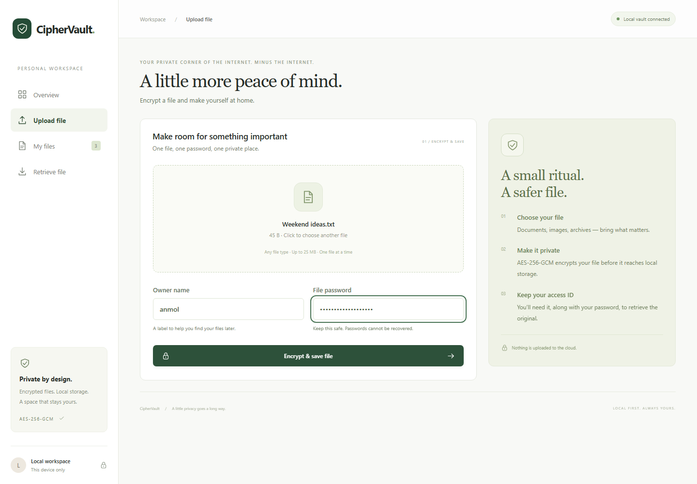
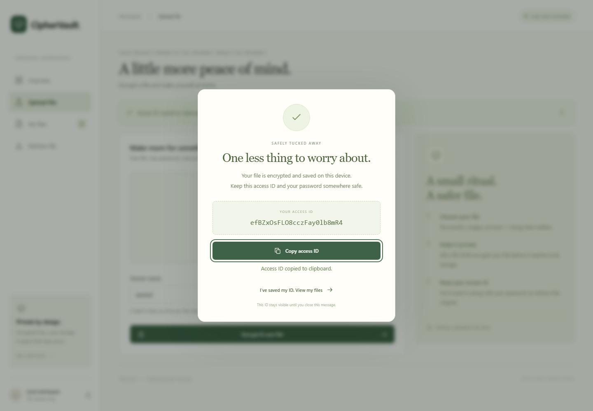
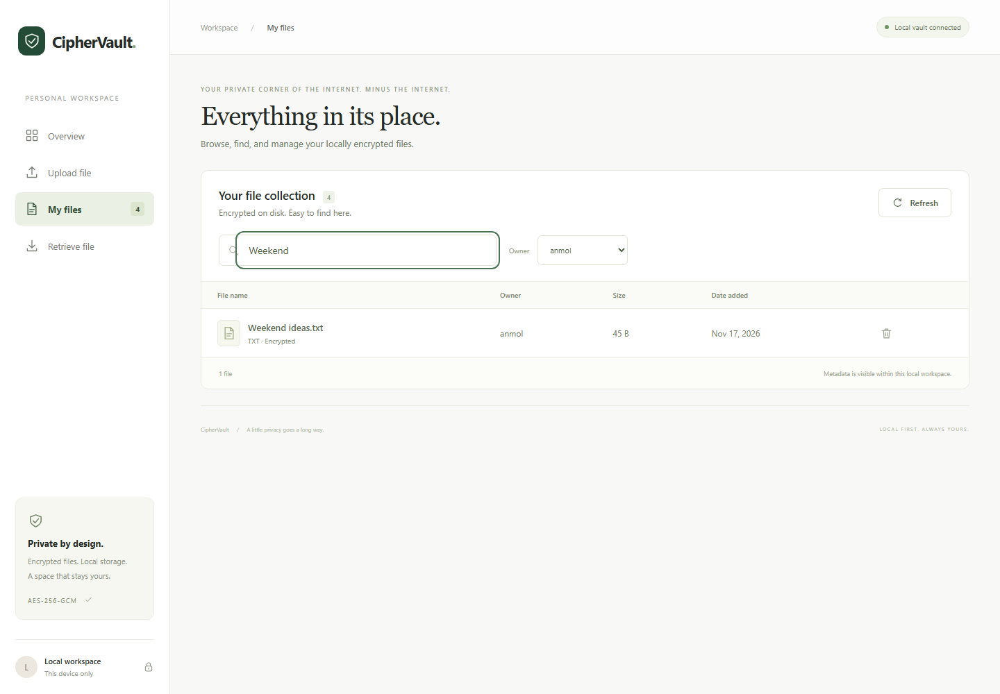
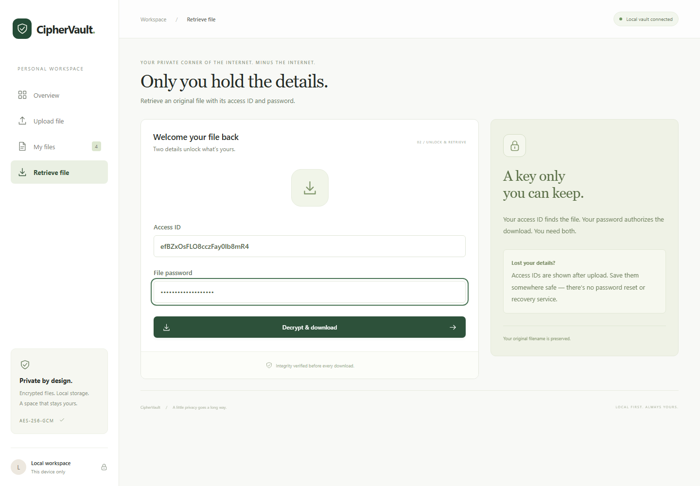

# CipherVault

### Keep it close. Keep it yours.

A private file vault for your own computer, with a calm sage interface, encrypted local storage, and password-protected retrieval. Built with React, FastAPI, SQLite, and AES-256-GCM.

**Runs locally. No cloud account, Google Drive token, hosted database, or environment file required.** After installing dependencies, the application works without internet access. There are no deployment steps or hosting integrations.


## What you can do

- **See your vault at a glance:** file count, total original file size, encryption information, and recent uploads.
- **Upload any file type:** browse or drag and drop one file up to 25 MB, add an owner label, and set its password.
- **Save your access ID:** copy the generated ID from a confirmation that stays open until you dismiss it.
- **Find your files:** search filenames and filter by owner in the local file collection.
- **Retrieve originals:** enter the access ID and password to decrypt and download with the original filename.
- **Delete deliberately:** confirm permanent deletion with the file password.
- **Use a smaller screen:** responsive navigation, stacked forms, and horizontally scrollable file tables.
- **Understand failures:** inline messages for incorrect passwords, missing files, oversized uploads, and an offline backend.

## Run locally

### Prerequisites

- Python **3.10 or newer**; tested with Python 3.10.11.
- Node.js **22.12 or newer**; tested with Node.js 22.19.0, and npm.
- Git to clone the repository.

### 1. Clone and install

```powershell
git clone https://github.com/Anmol-Kapil/CipherVault.git
cd CipherVault
python -m venv .venv
```

On **Windows PowerShell**, install Python dependencies using the virtual environment directly; activation is unnecessary:

```powershell
.\.venv\Scripts\python.exe -m pip install -r requirements.txt
cd frontend
npm ci
cd ..
```

On **macOS or Linux**, use `.venv/bin/python` in place of `.\.venv\Scripts\python.exe`:

```bash
.venv/bin/python -m pip install -r requirements.txt
cd frontend
npm ci
cd ..
```

### 2. Start the backend — terminal one

From the **repository root**, on Windows:

```powershell
.\.venv\Scripts\python.exe -m uvicorn backend.main:app --host 127.0.0.1 --port 8000
```

On macOS or Linux:

```bash
.venv/bin/python -m uvicorn backend.main:app --host 127.0.0.1 --port 8000
```

The first start creates the SQLite database, encrypted-file directory, and persistent encryption key automatically. Local API documentation is at [127.0.0.1:8000/docs](http://127.0.0.1:8000/docs).

### 3. Start the frontend — terminal two

From the repository root:

```powershell
cd frontend
npm run dev
```

Open **[http://127.0.0.1:5173](http://127.0.0.1:5173)**. The connection badge should read **Local vault connected**. Both servers bind to loopback. Stop each with **Ctrl+C**.

Use the Vite development server for this local application. Its `/api` proxy forwards to port 8000; opening a built HTML file directly will not provide that proxy.

## Feature walkthrough and screenshots

These screenshots were captured from the running local app using real uploads, downloads, filtering, validation, and deletion. They use synthetic example files only. The sample access ID belongs to a test file that is deleted at the end of the walkthrough. Example content is not added to your vault on startup.

### 1. Overview

View recent uploads, encrypted file count, and the sum of original file sizes. The size statistic excludes encryption overhead and database size.


### 2. Encrypt and upload

Choose or drop a file, enter an owner label, and set a password of at least 8 characters. Passwords must fit within bcrypt's 72-byte limit; non-ASCII characters can use more than one byte. The backend validates the limit.



### 3. Save and copy the access ID

Store the ID and password somewhere safe. The ID remains visible until you choose **I've saved my ID. View my files**. Clipboard access uses the browser's local secure-context support; you can also select and copy the ID manually.



### 4. Browse files

The collection lists filenames, owner labels, original sizes, and upload dates. Refresh reloads metadata from the local backend.


### 5. Search and filter by owner

Filename search is case-insensitive. Owner filtering matches the selected label exactly. Owner names are organizational labels, not signed-in accounts.



### 6. Password validation

An incorrect password produces a readable inline error and does not download the file.


### 7. Retrieve a file

Enter its access ID and password, then choose **Decrypt & download**. AES-GCM verifies integrity before returning the original bytes.



### 8. Successful download

The browser receives the original content and filename. The password field clears after success.


### 9. Password-confirmed deletion

Choose the trash icon, enter the file password, and confirm. **Keep file** cancels. Deletion removes both the encrypted blob and its database record; it cannot be undone in the app.


### 10. Mobile layout

The navigation moves above the content. Forms stack vertically, and wide tables scroll within their own container.


## How local storage works

```text
Browser at 127.0.0.1:5173
  React + Vite
       |
       | /api proxy (same origin)
       v
FastAPI at 127.0.0.1:8000
       |
       +-- AES-256-GCM --> .local-data/blobs/<random-access-id>.bin
       +-- bcrypt ------> .local-data/vault.db (password hashes + metadata)
       +-- installation key --> .local-data/master.key
```

| Path | Purpose |
| --- | --- |
| `backend/main.py` | Local REST API, input validation, upload, retrieval, and deletion |
| `backend/encryption/crypto.py` | AES-GCM encryption and persistent installation key |
| `backend/database.py` / `backend/models.py` | SQLite connection and metadata model |
| `frontend/src/App.jsx` | Overview, upload, collection, retrieval, and dialogs |
| `frontend/src/App.css` | Responsive sage-and-cream visual design |
| `frontend/e2e/vault.spec.js` | Browser walkthrough and screenshot generation |
| `tests/test_vault.py` | Isolated API and encryption regression tests |
| `docs/screenshots/` | Actual screenshots embedded in this README |

All private runtime data is stored in **`.local-data/`**, which is excluded from Git. The optional `CIPHERVAULT_DATA_DIR` environment variable changes that directory; normally you do not need to set anything. The older `storage/` sample is retained from the original repository and is not read by this version.

### Backups and security boundaries

- Stop the backend before backing up **the entire `.local-data/` directory together**, including `master.key`, `vault.db`, and `blobs/`.
- The key persists across restarts. Losing or replacing it makes existing encrypted files unreadable. Never commit or share it.
- File contents are encrypted at rest. Filenames, owner labels, MIME types, sizes, and timestamps are plaintext metadata in SQLite.
- Passwords are bcrypt hashes. The password authorizes retrieval/deletion; encryption uses the installation key. This is server-side encryption, **not end-to-end encryption or a zero-knowledge vault**.
- This is a **single-user local learning project**. Metadata listing has no login, account isolation, or session authentication. Anyone with access to the computer or local API can view metadata. Owner labels do not establish identity.
- Keep both servers on `127.0.0.1`. This project has no public-server hardening, rate limiting, or deployment configuration. It is not intended to be exposed to a network.
- No application password recovery exists. A person with filesystem access to the key and encrypted blobs can bypass the API's password check. Use OS account permissions and disk encryption to protect the device.
- Existing Google Drive files from the previous cloud version are not migrated. This version creates a fresh local vault. The old random-per-process encryption key could not reliably decrypt files after a restart.

## Local API

Frontend calls use `/api` and are proxied to the following backend paths:

| Method | Path | Input / result |
| --- | --- | --- |
| GET | `/` | Health and local storage mode |
| POST | `/upload` | Multipart: `file`, `username`, `password`; returns generated `access_id` and numeric `file_id` |
| GET | `/files` | All local metadata, newest first; excludes access IDs and password hashes |
| GET | `/user-files/{username}` | Metadata for an exact owner label |
| POST | `/download` | JSON: `access_id`, `password`; returns original bytes as an attachment |
| DELETE | `/files/{id}` | JSON: `password`; deletes the matching blob and metadata |

Passwords are sent in request bodies, not URL query strings. The browser UI communicates with the Vite proxy; the backend does not enable wildcard CORS.

## Checks and screenshot reproduction

Install test dependencies from the repository root:

```powershell
.\.venv\Scripts\python.exe -m pip install -r requirements-dev.txt
.\.venv\Scripts\python.exe -m unittest discover -s tests -v
```

Use `.venv/bin/python` on macOS or Linux. Backend tests use a temporary directory and do not touch your personal vault. They cover exact-byte round trips, persistent key loading, Unicode download names, metadata filtering, wrong credentials, deletion, tamper detection, and upload limits.

With both local servers running, in `frontend/`:

```powershell
npm run lint
npm run build
npx playwright install chromium
npm test
```

The browser test creates synthetic files, exercises the real API through the UI, verifies the downloaded bytes and filename, checks mobile overflow and the offline state, and writes the ten README screenshots. It removes only the test files it created. `npm run build` is a compilation check; no hosting setup is included.

To format frontend source and tests:

```powershell
npm run format
```

## Troubleshooting

| Issue | What to check |
| --- | --- |
| Backend offline badge | Start the backend from the repository root on port 8000, then use reconnect. |
| Port 5173 already in use | Stop the other process or the previous Vite session. This project uses a strict frontend port. |
| Upload rejected | Select one file no larger than 25 MB; use a nonblank owner and an 8-to-72-byte password. |
| Incorrect password / missing ID | Use the exact credentials saved after upload; metadata is not a recovery mechanism. |
| File integrity check fails | Restore the matching blob and key from your backup. Do not generate a replacement key. |
| Dependencies fail to install | Verify Python and Node versions and internet connectivity for the installation step. |
| Old cloud files are absent | This local version uses its own database and encrypted blobs; cloud records are not imported. |

Created by [Anmol Kapil](https://github.com/Anmol-Kapil). Intended for learning and portfolio use.
